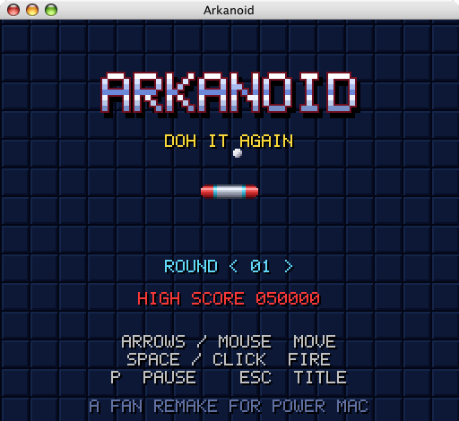
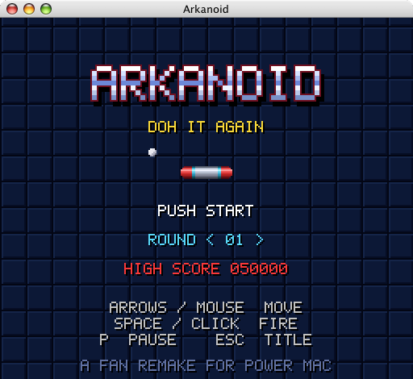

# Arkanoid for Mac OS X 10.4 Tiger (PowerPC)



A fan remake of Arkanoid in the style of the Super Nintendo game (Arkanoid: Doh It Again), written as a Cocoa
app for Mac OS X 10.4 on PowerPC. Its only file beside the program is its icon: the code draws every sprite,
wall and background into a 256 by 224 picture, as the SNES does, and a small synthesizer makes every sound.

## Download

The newest release is on [tiger.v2core.com](https://tiger.v2core.com/#arkanoid): a disk image, with its
SHA-256 and MD5. On the Tiger Mac itself, type `http://tiger.v2core.com/` in Safari, with http: Tiger cannot
open the https address. Open the disk image and drag Arkanoid to Applications.

## The game

- 32 rounds, then DOH in the final round (16 hits). On rounds 5, 10, 15, 20, 25 and 30 a Guardian patrols
  below the wall.
- Silver bricks take more hits the later the round; gold bricks do not break. Enemies come in through the
  gates in the top wall.
- You start with 2 spare lives, get one more at 20,000 points and one every 60,000 after that.
- After game over you can continue on the same round, with the score back at 0.
- The high score is kept in `~/Library/Preferences/local.exe.arkanoid.plist`.
- On the title screen the arrow keys choose the round you start on (1 to 32, or DOH). Left alone for 15
  seconds, the title screen plays the story or a demo.

| Capsule | What it does |
|---|---|
| S, Slow | slows the ball |
| C, Catch | the ball sticks to the Vaus until you fire |
| L, Laser | the Vaus shoots while you hold fire |
| E, Enlarge | the Vaus grows from 32 to 48 pixels |
| D, Disruption | the ball splits into three |
| B, Break | opens a gate in the right wall: go through it to the next round |
| P, Player | an extra Vaus |

| Keys | |
|---|---|
| Left and right arrows, or the mouse | move |
| Space, Z, X, or a click | fire, launch the ball |
| Return | start |
| P | pause |
| Esc | back to the title screen |



## Build

Xcode 2.5 on Mac OS X 10.4, with the 10.4u SDK. Open `Arkanoid.xcodeproj` and build, or:

```sh
xcodebuild -configuration Release    # build/Release/Arkanoid.app
```

The app is PowerPC only and runs on 10.4 and later. It links only Mac OS X's own frameworks: Cocoa, OpenGL,
AudioUnit, CoreAudio, CoreServices and CoreFoundation.

On the machine that serves tiger.v2core.com, `./package.sh` makes the release: it builds the committed tree in
the Tiger apps' scratch guest (`/www/tiger-kit`, started with its `guest-boot.sh`) and writes
`dist/Arkanoid-<version>.dmg` and its `.sha256`, with the version from `Info.plist`. The site's build, every 2
minutes, picks up the newest image there.

| File | What it does |
|---|---|
| `src/main.m` | the app, its menus and its window: the largest of 3, 2 or 1 times the game's size that fits the screen, resizable at 256:224 |
| `src/GameView.m` | runs the game at 60 steps a second, reads the keys and the mouse, and shows the 256 by 224 picture with OpenGL, scaled without smoothing |
| `src/game.c` | the rounds, the rules, the story and the drawing of everything in the game |
| `src/gfx.c` | the picture's pixels, shadows, fades and text |
| `src/sound.c` | a 4-channel chip-style synthesizer on Core Audio's default output |
| `resources/` | the icon, `Arkanoid.icns`, and the disk image's `Read Me.txt` |
| `tools/make-icon.py` | draws the icon as pixel art in the game's colours: `docs/icon.svg` for the site and `resources/Arkanoid.icns`, with the classic sizes Tiger reads (no PNG elements, which are 10.5's) |
| `package.sh` | the release (above) |

The GIF is the released 1.0, installed from tiger.v2core.com in a QEMU Power Mac G4 on Mac OS X 10.4.11 and
played by a script through the Mac's screen sharing, at about 22 frames a second.

Arkanoid is a trademark of Taito. This remake has no code, pictures or sound from Taito's games.
